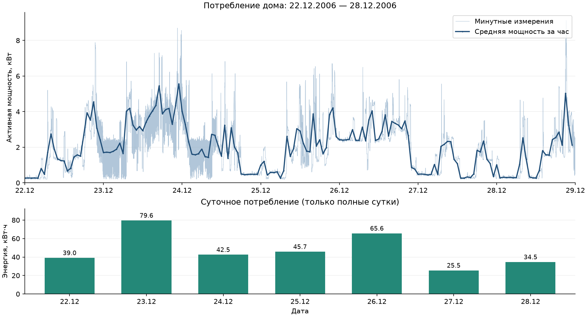

# Потребление электроэнергии по дням

Два скрипта на Python и pandas для анализа показаний одного дома с 16.12.2006 по 26.11.2010. Минутные данные и суточная сводка входят в репозиторий. График можно построить сразу после установки зависимостей.

## Быстрый запуск

В PowerShell откройте папку проекта. Проверено на Python 3.11.

```powershell
python -m venv .venv
.\.venv\Scripts\python.exe -m pip install -r requirements.txt
.\.venv\Scripts\python.exe plot.py
```

Введите начало и конец периода в формате `ГГГГ-ММ-ДД`. Обе даты входят в расчёт. Два нажатия Enter выбирают весь период. Скрипт открывает график и сохраняет PNG в `plots/`. Для сохранения без открытия окна можно сразу передать даты.

```powershell
.\.venv\Scripts\python.exe plot.py --start 2006-12-22 --end 2006-12-28 --no-show
```



Сверху — минутная мощность и средняя за каждый полный час. Снизу — расход за сутки, для которых есть все 1 440 показаний. Измеренный расход за неполные дни доступен в [суточной таблице](data/daily.csv).

## Данные и очистка

В [minutes.zip](data/minutes.zip) лежит очищенный минутный CSV со всеми семью показателями. Для повторной обработки укажите путь к исходному архиву или TXT.

```powershell
.\.venv\Scripts\python.exe prepare.py "$env:USERPROFILE\Downloads\archive.zip"
```

Три результата в `data/` — минутные показания, суточная сводка и счётчики очистки. [Подробное объяснение кода, структуры и расчётов](GUIDE.md).

Исходные данные — *Individual Household Electric Power Consumption*, Georges Hebrail и Alice Berard. В проекте данные очищены и сгруппированы по дням. [UCI Machine Learning Repository](https://doi.org/10.24432/C58K54) · [CC BY 4.0](https://creativecommons.org/licenses/by/4.0/).
